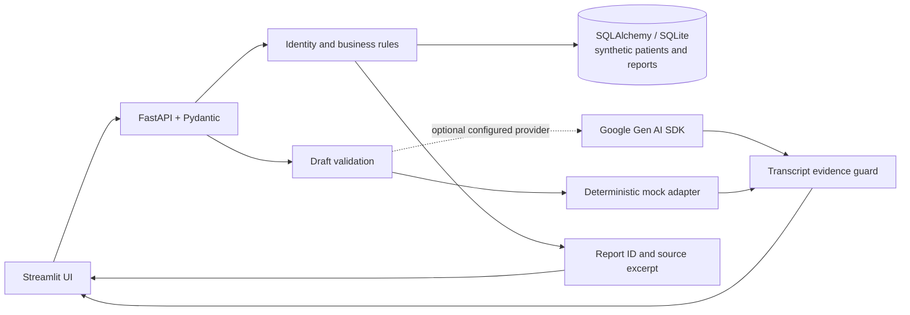

# Architecture

The Streamlit interface submits typed requests to FastAPI. Pydantic validates input and output; SQLAlchemy owns the configured SQLite connection pool and declarative models. Parameterized database operations keep patient matching and report selection deterministic. The database is seeded only when empty from fictional JSON records.

## Request and safety boundaries

- **Voice/STT:** only typed transcript is currently implemented. A future STT adapter should display recognized text for correction before the dictation endpoint receives it. The app never claims to process audio or images today.
- **Intent and tools:** deterministic parsing handles the supported retrieval command patterns. `patient_search`, `list_reports`, and `get_report` perform validated, parameterized lookup; ambiguous identities return clarification candidates instead of selecting a fuzzy first match. `POST /assistant/select-report` sets a validated report context.
- **Gemini:** the optional official `google-genai` adapter reads its key/model from environment config, requests Pydantic structured output, and applies a timeout. Retrieval and report chat remain deterministic. Provider errors are surfaced as 503; there is no silent Gemini-to-mock fallback.
- **Drafting:** mock mode preserves transcript text exactly and extracts a site only when it is explicit. Gemini output is schema validated and the observation/site must be present in transcript text or it is rejected. Saved drafts remain drafts; there is no finalize endpoint. Clinician review is required.
- **Conversation:** context is keyed by a caller session ID in process memory, isolated across IDs, and cleared by reset. Answers use only selected report findings and include report ID/excerpt. Unsupported information is stated as not documented.
- **Errors and privacy:** malformed inputs receive Pydantic 422, missing IDs 404, and provider failures safe 503 messages. API credentials are not returned to the UI. Demo access is open and all records are synthetic. Production requires authn/authz, encryption, retention/deletion, data-handling review, safe audit design, and clinical/operational validation.
