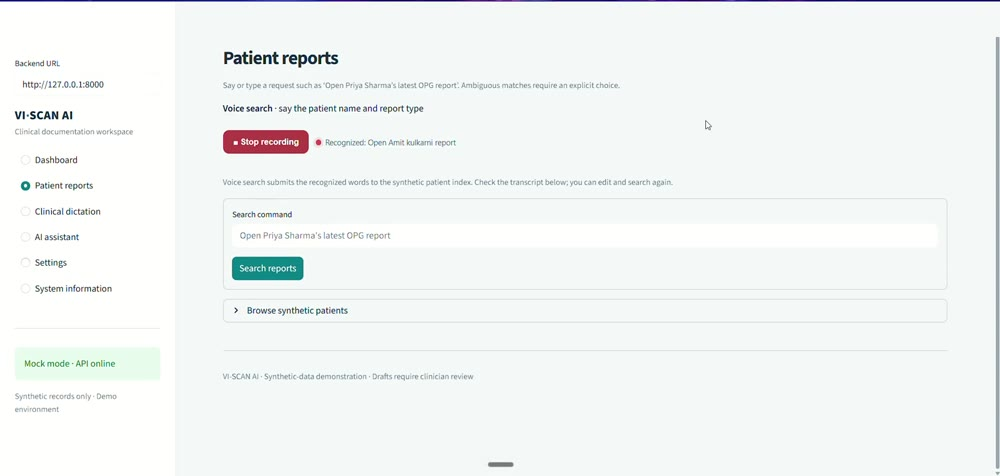

# VI-SCAN AI

**A voice-enabled dental report assistant demo** for synthetic patient report retrieval, clinician dictation, and evidence-grounded follow-up.

> Educational demo only. The dataset is synthetic. This software is not a diagnostic system and is not for clinical use.

## Demo

Click the preview to open the full recording:

[](assets/viscan-demo.mp4)

The included MP4 is a compressed, GitHub-friendly copy of the recording.

## What it does

- **Voice report search:** speak a request such as “Open Priya Sharma’s latest OPG report.” The app searches the synthetic index and asks you to choose when a name is ambiguous.
- **Voice dictation:** speak a clinical observation, review and edit the transcript, then generate an editable structured draft.
- **Report assistant:** ask follow-up questions about the selected report. Answers show report evidence and say when information is not documented.
- **Provider options:** use deterministic mock mode, Gemini, or an optional local Hugging Face model for draft generation.
- **Draft persistence:** save draft reports in SQLite. Drafts remain drafts and require clinician review.

Voice recognition uses the browser’s speech-recognition capability and requires microphone permission. Recognized text is sent to the app; typed input is available if voice recognition is unsupported. Browser speech recognition may use the browser’s speech service.

## Quick start

Requirements: Python 3.11 or newer.

In PowerShell, from the project directory:

```powershell
python -m venv .venv
.venv\Scripts\Activate.ps1
python -m pip install -r requirements.txt
Copy-Item .env.example .env
```

Start the backend and UI in separate terminals:

```powershell
python -m uvicorn app.main:app --reload
```

```powershell
streamlit run app/ui.py
```

Open the Streamlit URL printed in the terminal (usually `http://localhost:8501`). The API and interactive docs are at `http://127.0.0.1:8000` and `http://127.0.0.1:8000/docs`.

Mock mode is the default and works without a key or model download. In the browser, open **Patient reports** or **Clinical dictation** and allow microphone access when prompted.

## Choose an AI provider

The provider setting applies to the current browser session. Report retrieval and follow-up remain deterministic and evidence-grounded for every provider.

### Deterministic mock

Select **Use deterministic mode** in **Settings**. This is the offline option and preserves the transcript in the generated draft.

### Gemini

In **Settings**, choose **Gemini · Google**, enter a supported model and API key, then select **Test and activate**. The key is held in backend memory for the session; it is not saved to SQLite or returned by the API. Use a local backend or HTTPS URL when sending a key. Gemini requires network access and may incur provider costs.

For environment-based configuration, set the values in `.env`:

```dotenv
LLM_PROVIDER=gemini
GEMINI_API_KEY=your_api_key_here
GEMINI_MODEL=your_supported_model_name
```

Never commit a real API key.

### Local Hugging Face model

In **Settings**, choose **Local · Hugging Face**, leave the model ID as `google/flan-t5-small`, and select **Test and activate**. This public model runs on CPU. Its first use downloads the model files (about 308 MB); later uses load them from the local cache. No Hugging Face API token is required for this public model.

Install the optional packages before selecting the local model:

```powershell
python -m pip install -r requirements-local.txt
```

The local model receives the transcript on the machine running the backend. Output is schema-checked and screened against the transcript. If the model cannot load or returns unsupported wording, the API reports an error; switch to deterministic mode for offline drafting.

## API examples

```powershell
curl.exe http://127.0.0.1:8000/health

curl.exe -X POST http://127.0.0.1:8000/assistant/query `
  -H "Content-Type: application/json" `
  -d '{"text":"Open P001 latest OPG report","session_id":"demo"}'

curl.exe -X POST http://127.0.0.1:8000/reports/draft `
  -H "Content-Type: application/json" `
  -d '{"transcript":"Lower right third molar is horizontally impacted.","session_id":"demo"}'
```

Main routes: `GET /health`, `GET /patients`, `GET /patients/{patient_id}/reports`, `GET /reports/{report_id}`, `POST /assistant/query`, `POST /assistant/select-report`, `POST /assistant/follow-up`, `POST /assistant/reset`, `POST /reports/draft`, and `POST /reports/draft/{draft_id}/save`.

## Data and architecture

The app seeds SQLite from [`data/synthetic_reports.json`](data/synthetic_reports.json) when the database is empty. The included dataset has five fictional patients and ten reports. Set `DATABASE_URL` to use another SQLAlchemy database URL.

See [`ARCHITECTURE.md`](ARCHITECTURE.md) for the request and evidence flow and [`docs/demo_script.md`](docs/demo_script.md) for a short walkthrough.

## Run checks

```powershell
python -m pytest -q
```

## Limitations and privacy

- Microphone access depends on a compatible browser and user permission. Voice recognition may depend on an external browser speech service.
- Gemini requires a valid key and network access. The local model requires a one-time download. Live provider behavior depends on the user’s key, network, and model availability.
- Session context and provider settings are held in process memory and are cleared when the backend restarts.
- The demo has no authentication or patient authorization and supports no real patient records or image analysis.
- Before real deployment, add access controls, encryption, audit and retention policies, provider review, clinical validation, and operational monitoring. No regulatory compliance is claimed.
